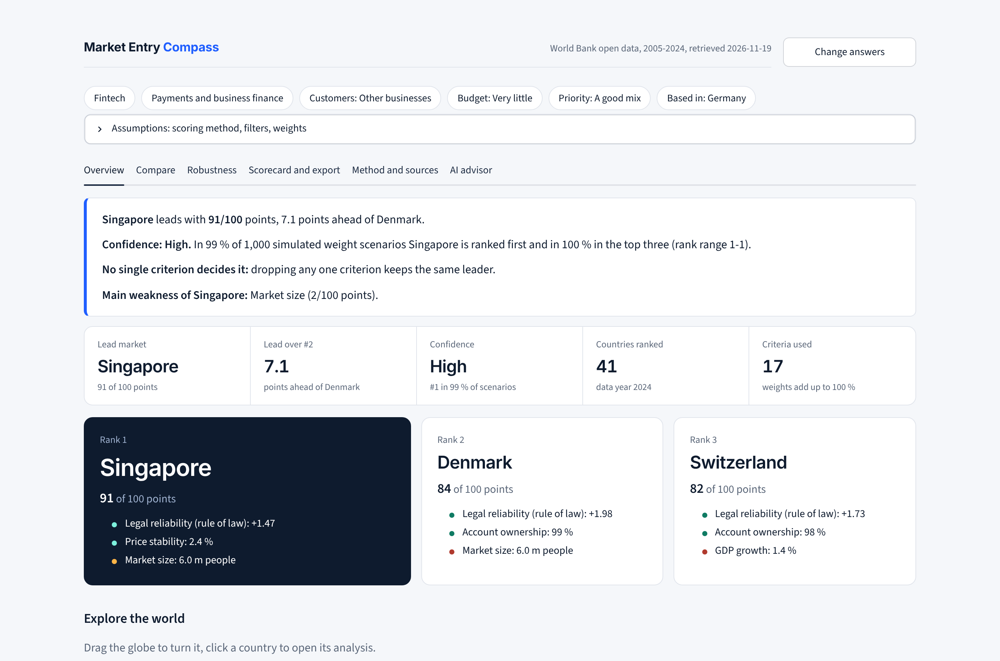
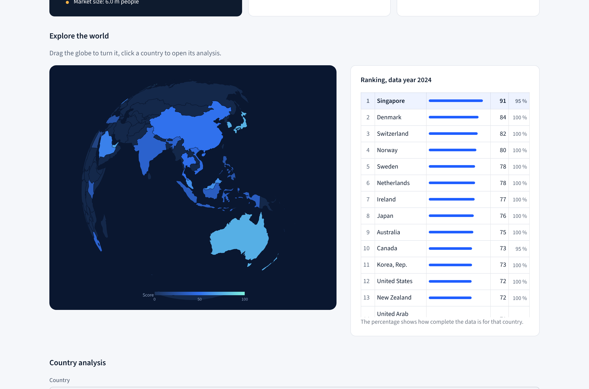
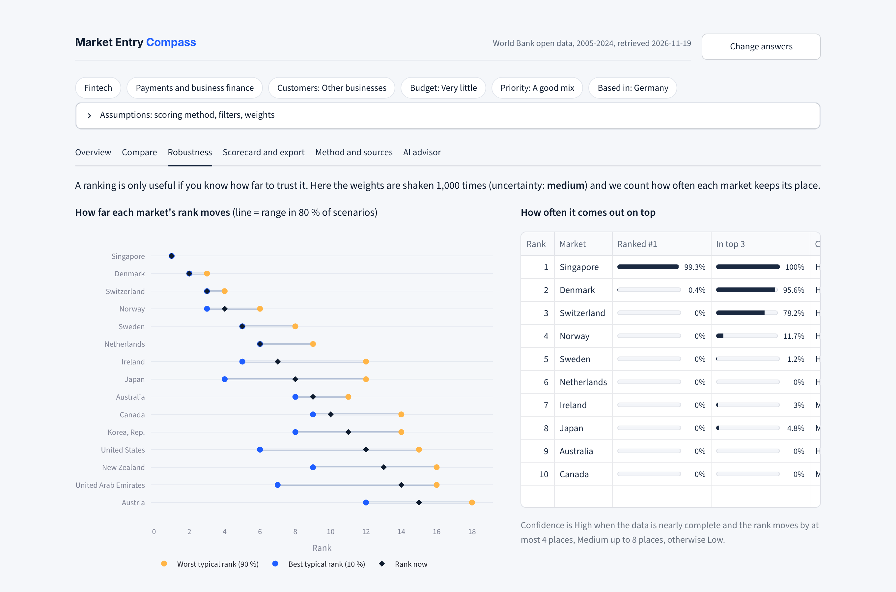
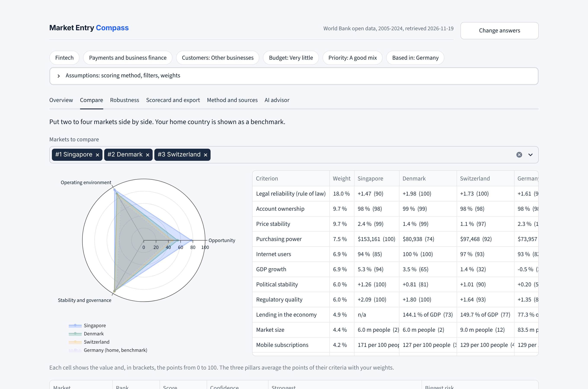
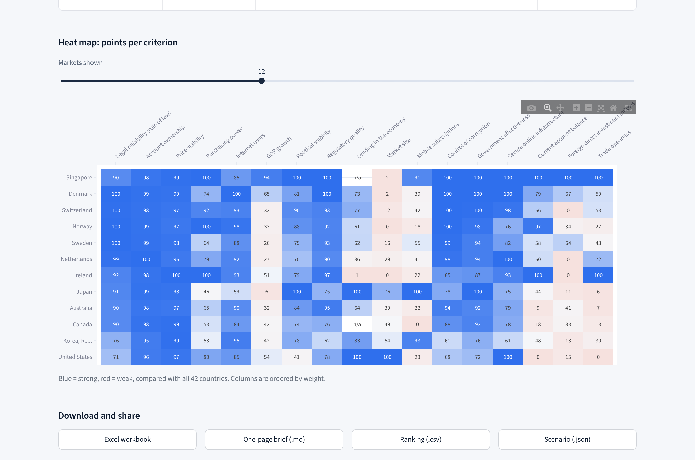

# Market Entry Compass

**Which country should your startup enter first?**

Most founders pick their first foreign market by gut feeling or by whom they happen to know. Large companies have strategy teams for this decision; early-stage startups do not. Market Entry Compass is a free, transparent screening tool for startups in any industry: you describe your startup, it ranks 42 countries with public data, shows them on a globe you can turn and click, and explains the result. An optional AI advisor (Claude) writes a detailed recommendation, restricted to the numbers the tool provides.

> Status: Version 5. A screening tool built on public data. Not a forecast, not investment, legal or tax advice.











*Screenshots with real World Bank data (fintech, payments, home country Germany).*

## Two ways to use it

- **Guided (first-time founders).** Seven plain questions with big answer cards, no jargon, then a result with a written explanation.
- **Workbench (analysts and investors).** The same result opens as a screening workbench: executive summary, three pillars, hard filters, a choice of scoring method, robustness tests, side-by-side comparison with a home benchmark, a full audit trail and Excel export.

## What it does

- **Seven industries, 21 focuses** (Fintech, software, health, energy, consumer, education, "Something else"). Each focus has its own weights; a payments fintech and a banking-for-the-unbanked startup want opposite things from "account ownership".
- **Executive summary:** leader, lead over #2, confidence, which criteria decide the answer, main weakness. Rule-based from the numbers.
- **Robustness:** weights are shaken 1,000 times to show how often each market stays first or in the top three, plus a confidence rating (High, Medium, Low) and a list of decisive criteria. A ranking without its uncertainty is not a decision basis.
- **Three pillars:** market opportunity, operating environment, stability and governance. Institutional criteria (political stability, regulatory quality, corruption, government effectiveness, external balance, FDI, openness) are part of every profile.
- **Assumptions you control:** scoring method (weighted average or balanced/weakest-link), hard filters (minimum stability, rule of law, population, income; maximum inflation), closeness to your home country (geographic and economic distance), and a slider for every weight.
- **Compare** two to four markets and the home country as a benchmark, with a pillar radar and a value table.
- **Scorecard and export:** sortable table, heat map, Excel workbook (assumptions, raw values, points, weights, robustness, filters, sources with indicator codes and retrieval date), one-page brief, CSV, and a scenario file that restores all assumptions. The page address holds your answers, so results can be shared as a link.
- **3D globe:** drag to rotate, click a country to open its analysis.
- **AI advisor (optional):** Claude writes an investment-memo style recommendation from your profile, the evidence and the robustness results. It may only use the numbers the tool provides. You bring your own Anthropic API key; the app does not store it.

## How the score works

1. Every indicator is scaled to 0-100 points across all countries (outliers capped at the 5th/95th percentile).
2. Weights come from the industry focus, adjusted by customers, budget and risk priority, plus an institutional block for every profile.
3. Points are combined by weighted average or by weighted geometric mean (balanced).
4. Robustness tests show how stable the order is.

Indicators (World Bank open data): *core:* GDP growth, purchasing power, population, inflation (best near 2 %), internet users, rule of law. *Institutions:* political stability, regulatory quality, corruption control, government effectiveness, current account, FDI, trade openness. *Fintech:* account ownership, mobile subscriptions, private credit, secure servers. *SaaS:* broadband, R&D spending, researchers, ICT service exports, tertiary enrolment. *Health:* health spending, population 65+, physicians, hospital beds. *Energy:* renewable shares, electricity access, CO2 per person. *Consumer:* urban and working-age population, logistics performance, household spending.

Details and limits: [docs/methodology.md](docs/methodology.md).

## Run it yourself

```bash
git clone https://github.com/m42h8jpgw7-wq/market-entry-compass.git
cd market-entry-compass
python3 -m venv .venv
source .venv/bin/activate
pip install -r requirements.txt

python -m src.fetch_data     # downloads the data from the World Bank
streamlit run app.py         # opens the dashboard in your browser
python -m pytest             # runs the tests
```

For the AI advisor, paste your Anthropic API key into the AI advisor tab (console.anthropic.com). Without a key everything else works.

## Project structure

```
app.py               Streamlit app (guided questions, workbench tabs)
src/ui.py            stylesheet and small HTML helpers
src/config.py        countries, indicators, pillars, industries, weights, hard filters
src/profile.py       startup profile -> score weights
src/scoring.py       data panel, 0-100 scoring, methods, filters
src/analytics.py     robustness, pivotal criteria, distance, executive summary
src/evidence.py      numbers, trends, strengths, risks, data briefing
src/export.py        Excel workbook and one-page brief
src/state.py         shareable link and scenario file (validated)
src/advisor.py       prompt and streaming call to Claude
src/fetch_data.py    World Bank download
tests/               tests for scoring, pillars, filters, robustness, export, state
docs/                methodology and how to add an industry
```

## Roadmap

- [ ] More industries with their own indicators (see [docs/adding-an-industry.md](docs/adding-an-industry.md))
- [ ] Forecasts from published projections (IMF, UN), clearly labelled as estimates
- [ ] Regional data below country level, taxes, funding landscape
- [ ] Automatic check that every number in the AI text appears in the evidence
- [ ] Case study with real founders

## Data sources

World Bank open data: World Development Indicators, Worldwide Governance Indicators, Global Findex (CC BY 4.0).

## License

MIT
