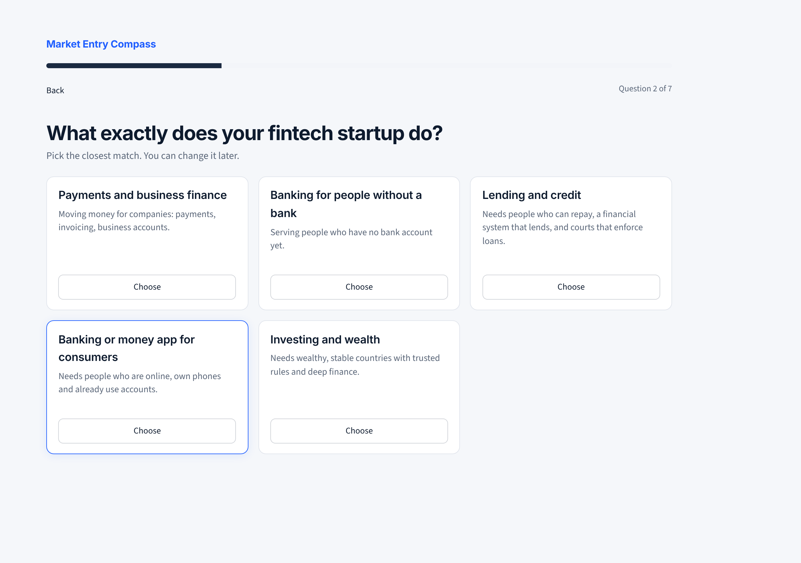
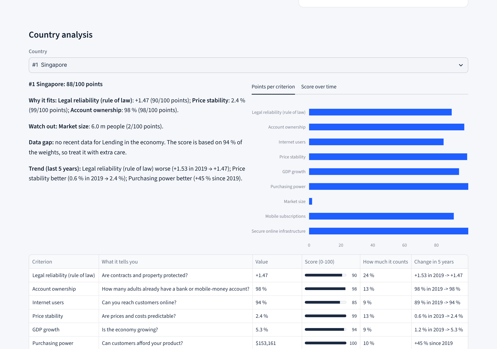

# Market Entry Compass

**Which country should your startup enter first?**

Most founders pick their first foreign market by gut feeling or by whom they happen to know. Large companies have strategy teams for this decision; early-stage startups do not. Market Entry Compass is a free, transparent screening tool for startups in any industry: you describe your startup, it ranks 42 countries with public data, shows them on a globe you can turn and click, and explains the result. An optional AI advisor (Claude) writes a detailed recommendation, restricted to the numbers the tool provides.

> Status: Version 4 (work in progress). A first screening tool, not a forecast and not legal or financial advice.






*Screenshots with real World Bank data (fintech, payments, home country Germany). Question 2 of 7, the result, and the country analysis.*

## What it does

- **Seven simple questions, no experience needed:** industry, what exactly you do, who pays, budget, what matters most, home country, and an optional free-text description. Big answer cards instead of forms, plain-language explanations everywhere.
- **Seven industries, 21 focuses:** Fintech, software for companies, health, energy and climate, shopping and consumer, education, and "Something else" for any other industry (you name it, general criteria are used). A payments fintech and a banking-for-the-unbanked startup want opposite things from "account ownership"; an off-grid energy startup wants LOW electricity access. Each focus has its own weights (see [`src/config.py`](src/config.py)).
- **Advanced (optional):** make any criterion count more or less with a slider and watch the ranking change.
- **3D globe:** drag to rotate, click a country to open its analysis.
- **Country analysis:** score, strengths, risks, five-year trends, a plain-language explanation of every criterion, score history since 2005.
- **Data briefing:** a rule-based written explanation, built only from the numbers.
- **AI advisor (optional):** Claude reads your profile and the evidence tables and writes a structured recommendation: why #1, why not the others, risks, first 90 days, what the data cannot tell you. It must justify every country with concrete data points and say what to verify. You bring your own Anthropic API key; the app does not store it.

## How the score works

1. Every indicator is scaled to 0-100 points across all countries (outliers capped at the 5th/95th percentile).
2. Weights come from the industry focus and are adjusted by your answers (customers, budget, risk priority).
3. The weighted points add up to the country score.

Indicators (World Bank open data): *core:* GDP growth, purchasing power, population, inflation (best near 2 %), internet users, rule of law. *Fintech:* account ownership, mobile subscriptions, private credit, secure servers. *SaaS:* broadband, R&D spending, researchers, ICT service exports, tertiary enrolment. *Health:* health spending, population 65+, physicians, hospital beds. *Energy:* renewable shares, electricity access, CO2 per person. *Consumer:* urban and working-age population, logistics performance, household spending.

Details and limits: [docs/methodology.md](docs/methodology.md).

## Run it yourself

```bash
git clone https://github.com/m42h8jpgw7-wq/market-entry-compass.git
cd market-entry-compass
python3 -m venv .venv
source .venv/bin/activate
pip install -r requirements.txt

python -m src.fetch_data     # downloads the data from the World Bank
streamlit run app.py         # opens the dashboard in your browser
python -m pytest             # runs the tests
```

For the AI advisor, paste your Anthropic API key into the Advice section (console.anthropic.com). Without a key everything else works.

## Project structure

```
app.py               Streamlit dashboard (profile form, globe, analysis, advice)
src/ui.py            stylesheet and small HTML helpers (design)
src/config.py        countries, indicators, industry profiles, weights
src/profile.py       startup profile -> score weights
src/scoring.py       data panel and 0-100 scoring
src/evidence.py      numbers, trends, strengths, risks, data briefing
src/advisor.py       prompt and streaming call to Claude
src/fetch_data.py    World Bank download
tests/               tests for scoring, profiles, evidence, prompt
docs/methodology.md  how it works and where it falls short
```

## Roadmap

- [ ] More industries with their own indicators (see [docs/adding-an-industry.md](docs/adding-an-industry.md))
- [ ] Forecasts from published projections (IMF, UN), clearly labelled as estimates
- [ ] Regional data below country level, taxes, funding landscape
- [ ] Automatic check that every number in the AI text appears in the evidence
- [ ] Case study with real founders

## Data sources

World Bank open data: World Development Indicators, Worldwide Governance Indicators, Global Findex (CC BY 4.0).

## License

MIT
